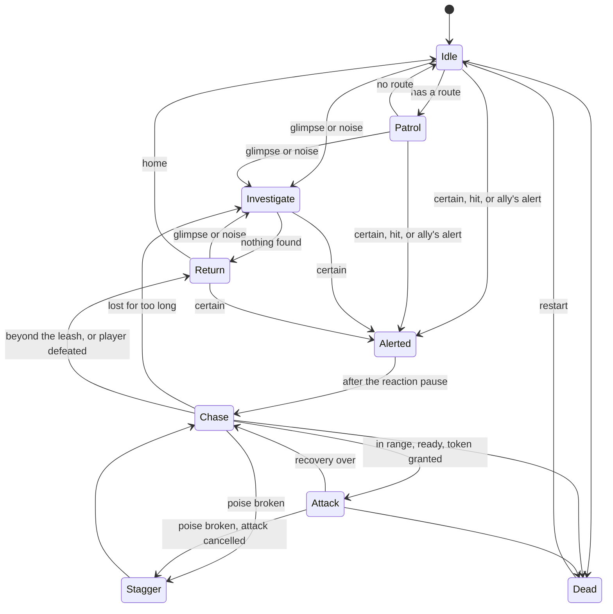

# Enemy AI

Sprint 8 adds the first enemies: the Ruins Guardian, a slow melee construct, and the Arcane Wisp,
a fragile ranged caster. They patrol, notice and investigate the player, chase, attack with clear
warnings, react to hits, and return to their posts. A new level, the Combat Arena, puts them
together in three encounters. The Mage can now be defeated, and restart brings everything back.

**Status:** the code compiles against Unity 6000.6.0f1 for the Editor and for Android, and the
decision logic passes 53 automated tests outside Unity. **Nothing has run in Unity yet.** Nobody
has seen an enemy move or played a fight. Every number below was set by calculation and
judgement and will need tuning once it can be played.

## What the player meets

| Enemy | Role | Health | How it fights | How to beat it |
| --- | --- | --- | --- | --- |
| **Ruins Guardian** | Slow, durable melee | 200 (10 bolts) | Closes in at 2.6 m/s and slams the ground in front of it. Below 60% health it adds a shockwave all around itself | Keep moving: it walks slower than the Mage. Step out of the glowing area before it fills. Punish the long recovery after each attack. Three quick hits during a wind-up stagger it and cancel the attack. A wall or column between you takes the blow |
| **Arcane Wisp** | Fragile ranged | 40 (2 bolts) | Floats 6 to 11 m away, backs off when approached, and fires slow bolts after a visible charge | Watch the aim line: it follows you, then brightens and stops. Step sideways when it stops. Every hit staggers a Wisp |

### Warnings (telegraphs)

Every attack is announced before it lands, and the warning shows both where and when.

| Attack | Warning | Wind-up | Follows the player for | Recovery | Damage |
| --- | --- | --- | --- | --- | --- |
| Guardian Slam | Arms rise, the chest core flares, a 110° slice of ground 2.7 m deep fills with orange light | 0.95 s | the first 0.52 s | 1.1 s | 24 |
| Guardian Shockwave | As above, with a full circle 3.6 m wide | 1.3 s | not at all | 1.4 s | 18 |
| Wisp Arcane Mote | The core glows and grows; a thin violet line points at the player, then holds still and brightens | 0.8 s | the first 0.56 s | 0.4 s | 12, flying at 13 m/s |

After the "follow" period the attack is locked, so a player who moves at that moment avoids it.
The Mage has 100 health: five Slams, or nine Motes.

### Behaviour

1. **Idle and patrol.** Unaware enemies stand at their post or walk a route, pausing at each point.
2. **Noticing.** Seeing the player raises the enemy's awareness, quickly up close and slowly at the
   edge of sight (Guardian 13 m, Wisp 17 m). Within 2.5 to 3 m a visible player is noticed at
   once, whichever way the enemy faces. Walls and columns block sight.
3. **Investigation.** A glimpse, or a noise (a bolt striking a wall nearby, a Guardian's slam),
   sends an unaware enemy to look. It walks there, looks around for a few seconds, and goes home.
4. **Alert.** Once sure, the enemy stops, turns to the player, shows a small glowing marker above
   its head, and pauses (Guardian 0.8 s, Wisp 0.5 s) before acting. The rest of its group joins
   in one by one, after delays spread between 0.25 and 0.9 s, rather than all at once.
5. **Chase.** Guardians close in when they may attack and otherwise wait in a ring about 4.5 m
   from the player, facing them. Wisps keep within 6 to 11 m with a clear view, back away from a
   player who closes in, and drift to new positions between shots. A Wisp with nowhere to go
   fights at close range.
6. **Losing the player.** Out of sight for 5 to 6 s, the enemy searches the last known position,
   then returns. Just after losing sight it still follows where the player went, so enemies do not
   stop dead at every corner.
7. **Leash.** An enemy that has gone more than about 20 m from home while the player is further
   still gives up, walks home, and ignores the player until it gets there.
8. **Hit reactions.** Every hit flashes the enemy and shows a number. Enough damage in quick
   succession staggers it (Guardian: 55 within a short time; Wisp: any hit): it is pushed back, its
   attack is cancelled, and for a short time it cannot be staggered again, so it cannot be locked
   in place by constant fire. Since Sprint LM-02 a hit carries a stagger value apart from its
   damage, so the Mage's Aegis strikes stagger far sooner than their damage suggests. Enemies can
   also be heated and set alight by Flame, and pushed by the Force Pulse along their navigation
   surface (Guardian: resists 60% of a push and heats slowly; Wisp: thrown the full distance and
   heats quickly). See `Docs/Disciplines.md`.
9. **Defeat.** The enemy stops, stops blocking movement and shots, bursts, and sinks (Guardian) or
   fades (Wisp). It stays down until the level restarts.

### Readable encounters

A director in each scene hands out attack "tokens". An enemy may only start an attack while it
holds one, and gives it back when the attack is over. At Normal difficulty:

- at most two enemies attack at the same moment, and at most one of them in melee;
- two attacks never start less than 0.5 s apart, so their warnings do not overlap;
- an enemy outside the camera's view waits at least 1.5 s longer before it may attack;
- among enemies waiting, the one that has waited longest goes first.

### Player defeat and restart

At zero health the Mage stops moving and casting, and a panel offers "Try again" (or press R, or
Start on a gamepad). Restart puts every enemy back at its post at full health, refills the Mage,
and clears the objective. Nothing is reloaded.

## The Combat Arena

A walled ruin, 36 by 60 m, entered from the south. The walls are 4.5 m high, beyond what the Mage
can climb.

| Court | Encounter | What it teaches |
| --- | --- | --- |
| Outer Court | One Guardian patrolling across the court | The Guardian's warning, its slow turn and its recovery, in open ground with a little cover |
| Colonnade | Two Wisps, one hovering, one patrolling, among two rows of columns | Dodging shots and breaking line of sight. A fallen column across part of the approach makes enemies path round it |
| Sanctum | Two Guardians (one standing guard, one patrolling round the dais) and two Wisps on raised platforms reached by stairs | Everything together. The director keeps it readable |

The objective is "Clear the arena" (seven enemies); clearing it shows "Arena cleared" with the time.

The levels are linked: the arch at the south gate of the Fantasy Playground (behind the starting
point) is now a portal to the arena, and the arch behind the arena's starting point leads back.
A portal hides itself if its destination is not in Build Settings.

## Set up

1. Pull the branch on the laptop and let Unity import. The Console must show no red errors.
2. Run **Threefold > Setup > Combat Arena**. It creates `Assets/Scenes/CombatArena.unity` and
   builds and saves everything. The summary at the end reports validation and navigation results.
3. Press Play.
4. Optional, for the portal and the defeat panel in the courtyard: run **Threefold > Setup >
   Fantasy Playground** again and choose Rebuild.
5. Upload the new files from the laptop (see `Docs/DevelopmentWorkflow.md`).

The command generates:

| Generated | Where |
| --- | --- |
| Enemy prefabs, abilities, definitions, difficulty levels, materials, effects, the Mote projectile | `Assets/Threefold/Generated/Enemies` |
| The arena's navigation mesh | `Assets/Threefold/Generated/Navigation/CombatArenaNavMesh.asset` |
| Portal material | `Assets/Threefold/Generated/Combat/PortalVeil.mat` |
| The scene, added to Build Settings after the playground | `Assets/Scenes/CombatArena.unity`, `ProjectSettings/EditorBuildSettings.asset` |

Running it again rebuilds the arena's environment and navigation mesh. Enemies, the director,
the Mage, the HUD and anything added by hand are kept. To return to the default enemy layout,
delete the `ArenaEnemies` object and run it again. Generated assets are kept once they exist; to
regenerate them with default values, delete the whole `Generated/Enemies` folder.

Since Sprint 11 the command also applies the visual style to the arena's stonework, ground and
lighting (`Docs/VisualStyle.md`). The enemies keep their own materials and are not outlined.

The Android build workflow now assembles both scenes and builds them into one APK that starts
in the playground.

## Tuning

| To change | Where |
| --- | --- |
| Difficulty for the whole arena | `EnemyDirector` object: Difficulty field. Choose `DifficultyEasy`, `DifficultyNormal` or `DifficultyHard` |
| What a difficulty does | `Generated/Enemies/Difficulty*.asset` |
| Senses, speed, health, reactions, attack ranges, telegraph length, recovery, cooldown | `Generated/Enemies/RuinsGuardian.asset`, `ArcaneWisp.asset` |
| Damage, reach and width of the Guardian's attacks | `Generated/Enemies/GuardianSlam.asset`, `GuardianShockwave.asset` |
| Damage, speed and size of the Wisp's bolt | `Generated/Enemies/ArcaneMote.asset` |
| Patrol routes | Move the `Point` objects under each enemy's `Route` in the Scene view |
| Which enemies alert each other | `ArenaEnemies` > `Encounter …` objects: Members, alert radius and delays |
| How often enemies look for the player | Each enemy: Enemy Controller, Perception |
| Rebake the navigation mesh | Run **Threefold > Setup > Combat Arena** again. The Bake button on the arena's NavMeshSurface also works, but it stores its result as a separate file next to the scene and removes the generated one; the next run of the menu command creates the generated file again |

Difficulty levels at a glance:

| | Easy | Normal | Hard |
| --- | --- | --- | --- |
| Enemy health | 80% | 100% | 125% |
| Enemy damage | 70% | 100% | 130% |
| Enemy speed | 90% | 100% | 110% |
| How fast enemies notice | 75% | 100% | 135% |
| Telegraph length | 130% | 100% | 80% |
| Time between an enemy's attacks | 135% | 100% | 80% |
| Wisp aim: anticipation, scatter | none, 4° | half, 2° | 85%, 1° |
| Enemies attacking at once (melee) | 1 (1) | 2 (1) | 3 (2) |
| Least time between attack starts | 1.0 s | 0.5 s | 0.25 s |
| Extra wait when off screen | 2.5 s | 1.5 s | 0.8 s |

A test enforces that every telegraph still gives at least 0.6 s of warning on Hard.

## Architecture

Decisions, the Unity body and presentation are separate. The decision logic never touches a
Unity object, which is what lets it be tested without Unity.

| Layer | Files (under `Assets/Threefold/Scripts/Runtime`) | Knows about |
| --- | --- | --- |
| Decisions | `Enemies/EnemyBrain`, `EnemyStateMachine`, `EnemyStates`, `EnemyRules`, `EnemyMeters`, `AttackTokenPool` | Only `IEnemyBody`, plain numbers and positions |
| Data | `Enemies/EnemyTuning`, `EnemyArchetypes`, `EnemyDefinition`, `EnemyDifficulty` | Nothing |
| Body | `Enemies/EnemyController` (implements `IEnemyBody`) | NavMeshAgent, physics, the Ability Caster, Health |
| Coordination | `Enemies/EnemyDirector`, `EnemyEncounter`, `PatrolRoute` | The enemies, the camera, the session |
| Presentation | `Enemies/EnemyTelegraph`, `EnemyPresentation`; existing `HitFlash`, `WorldHealthBar`, `DamageNumbers` | Listens to the body's state |
| Combat additions | `Combat/MeleeStrikeDefinition`, `TargetAimProvider`, `CombatTeam` | The existing ability system |

Any state can go to Dead and, through damage, to Stagger or Alerted; the diagram shows the main
paths only.

**How the existing systems were reused**

- Enemies attack through the same `AbilityCaster` as the Mage. The Wisp's bolt is a
  `ProjectileSpellDefinition` like Arcane Bolt; the Guardian's attacks are a new kind of ability,
  `MeleeStrikeDefinition`, which a Rogue or Monk melee attack can use later.
- Enemy aiming is a second `AimProvider`, as the combat design anticipated.
- Enemies have the same `Health`, so damage numbers, hit flashes, health bars, camera shake and
  aim assist work on them without change.
- Projectiles and effects use the existing pools.

**Changes to earlier systems**

| Area | Change |
| --- | --- |
| `Health` | Has a team (Neutral, Player, Enemy). Projectiles and strikes pass over allies; training targets stay Neutral and can be hit by anyone. The setup puts the Mage on the Player team |
| `Projectile` | Passes over the shooter's allies; its impact makes a noise enemies can hear |
| `AbilityCaster`, `AbilityContext` | A damage multiplier, used for difficulty; a cast point can be set from code |
| `PrototypeSession` | Handles the player's defeat; restores anything that implements `IRestorable` (training dummies and enemies) |
| `ObjectiveHud`, `ObjectiveSetup` | A defeat panel; the objective's title, completion text and targets can be set per level |
| `CombatSetup` | Shared assets and helpers opened for the enemy generator; no empty dummy groups in levels without dummies |
| `FantasyPlaygroundSetup` | The south arch is a portal to the arena; lighting, background and placement helpers are shared |
| `PrototypeValidator` | Checks enemies, the director, the navigation mesh, and the defeat panel |
| `PrototypeBuild` | Builds both scenes |
| `Tools/ci/compile_check.sh` | Also compiles the AI Navigation package, which the setup tooling now uses |

The AI Navigation package (`com.unity.ai.navigation` 2.0.14) was already in the project. No package
was added.

## Performance

Estimates from the code, not measurements:

- **Sight** is checked 5 times a second per enemy while the player is within 22 m or the enemy is
  fighting, and about twice a second otherwise, with one raycast each time. Checks are spread
  across frames.
- **Paths** are only requested when the destination has moved more than 0.5 to 0.75 m. A new place
  to stand is chosen every 1.5 to 2 s, or at most every 0.4 s when urgent, by testing up to ten
  candidate points.
- **Navigation** is baked in the Editor and loaded with the scene; nothing is built at runtime.
  Seven agents use medium-quality avoidance.
- **Allocation:** physics queries use fixed buffers, the decision logic allocates nothing per
  frame, and the attack token pool reuses its lists. Confirm with the Profiler.
- **Effects:** each enemy has two flat shapes, one glow quad and, for Wisps, one line, all hidden
  except during a wind-up. Bolts and bursts are pooled (at most 16 Motes). No lights, no particle
  collisions, no textures beyond the shared glow.
- **Rendering:** a Guardian is about 16 primitive parts and a Wisp about 8, counting the warning and
  health-bar parts that are usually hidden. Telegraph colours are set through property blocks,
  which takes those renderers out of SRP batching while visible.

## Tests

Engine-free (run by `Tools/ci/compile_check.sh`, all passing):

- `EnemyBrainTests` (25): patrol; suspicion from a distant glimpse; instant notice up close; the
  reaction pause; noise within and beyond hearing; search and return; an investigation whose point
  is taken by another enemy still ends; ally alerts without loops;
  being hit while unaware; a full telegraphed attack with its lock and recovery; the Shockwave
  only below 60% health; two Guardians never attacking together; interrupting a wind-up; stagger
  immunity; searching where the player was last seen; the leash; a defeated player; defeat during
  an attack; reset; a restart during a wind-up leaves no cooldown; a Wisp backing away; a cornered
  Wisp; the order charge, lock, fire.
- `AttackTokenPoolTests` (9): limits, melee limit, spacing, off-screen delay, fairness, expiry.
- `EnemyRulesTests` (19): view cone, awareness, poise, geometry, attack choice, the struck area,
  difficulty scaling, minimum warning on Hard, speeds relative to the Mage, teams.

Need Unity (written, not run):

- `MeleeStrikeTests` (7): the strike against real colliders: opponents in front are hit; allies,
  targets behind and out of reach are not; a wall in between blocks it, an ally in between does
  not; neutral targets are hit; damage scaling; one hit per target.
- `CombatArenaAssemblyTests` (2, batch mode only): the arena validates with no problems, has seven
  enemies in three encounters, a baked navigation mesh, every enemy on it and reachable from the
  start; running the setup twice changes nothing.

## What needs checking in Unity

1. **Compilation in Unity**, including the new assembly reference to `Unity.AI.Navigation`.
2. **The setup command:** it should end with "Validation: no problems found" and report seven of
   seven enemies on the navigation mesh. Run it twice to confirm the navigation mesh asset is
   updated in place.
3. **Navigation:** enemies reach the platforms by the stairs, pass the gates, and go round the
   fallen column and columns. Turn on the NavMesh gizmo (AI Navigation overlay) to see it.
4. **Telegraphs:** the ground area must be visible on the paving and not flicker; the transparent
   material is set up from code and may need its surface settings confirmed in the Inspector.
5. **Feel:** reaction pauses, wind-up lengths, Wisp distance and Guardian speed.
6. **Performance on a phone** in the Sanctum, with all four enemies fighting.

## Known limits

- Not run in Unity and not played.
- The enemies are built from simple shapes and animated by moving those shapes. Models with an
  Animator can replace them later; the behaviour code does not depend on the visuals.
- No sound.
- The Mage has no defeat animation; it simply stops.
- Enemies stay on the ground navigation mesh. They cannot follow the player onto ledges reached by
  climbing, and the Wisp does not fly over obstacles. A player on a high ledge can be shot by Wisps
  but not reached by Guardians.
- Enemies do not hit each other, by design. They also see and shoot past each other.
- The navigation mesh is baked for the project's standard agent, 0.5 m wide. The Guardian is
  broader, so its shoulders can pass slightly into walls and columns when it walks close by them.
- Difficulty is chosen in the Inspector. There is no in-game menu for it.
- The portal loads the next scene in one step, which may cause a short pause on a phone.
